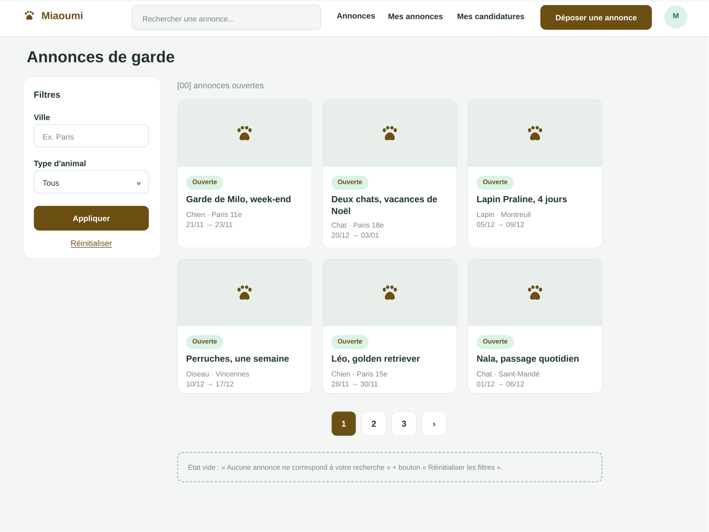
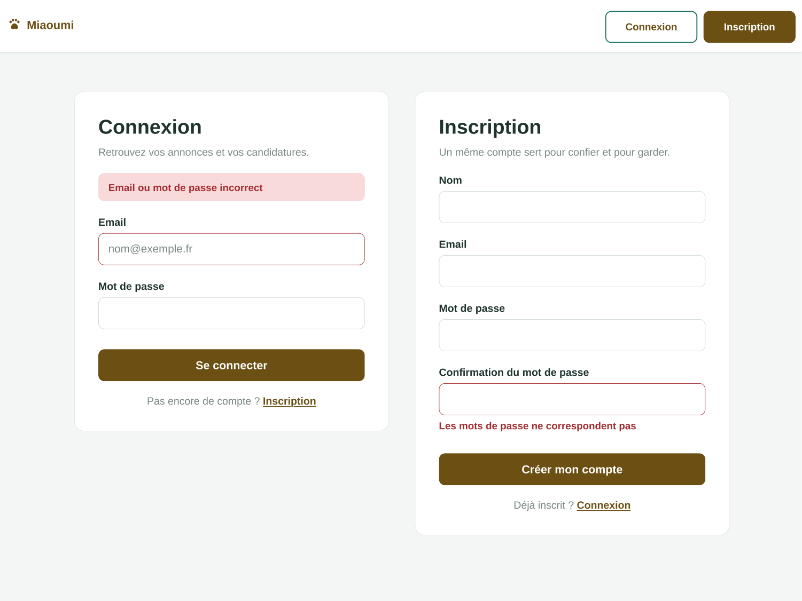
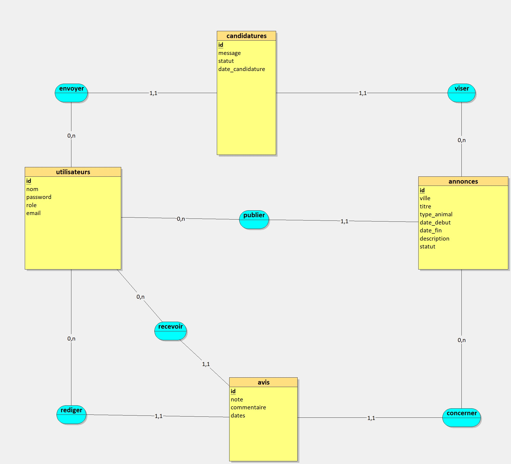
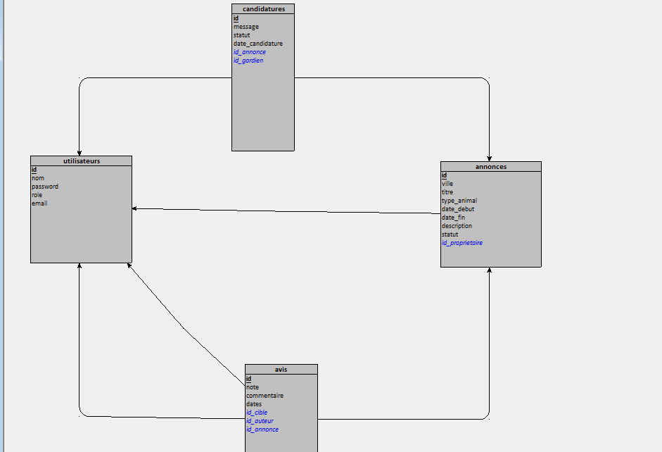
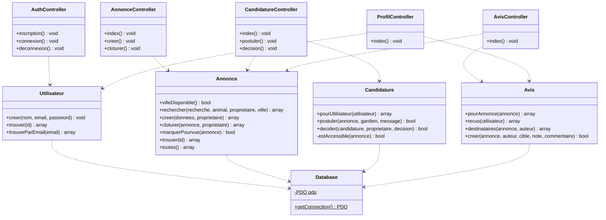

<p align="center">
  
</p>

<h1 align="center">Miaoumi</h1>

<p align="center">Des animaux bien entourés, des propriétaires rassurés.</p>

<p align="center">
  <a href="#maquette-du-site">Maquette</a> ·
  <a href="#modèle-conceptuel-des-données-mcd">MCD</a> ·
  <a href="#démarrer-en-local">Démarrer</a> ·
  <a href="docs/DEMARRAGE-WINDOWS.md">Guide XAMPP</a> ·
  <a href="CHANGELOG.md">Modifications</a> ·
  <a href="docs/GIT.md">Guide Git</a>
</p>

Site de mise en relation entre propriétaires d’animaux et gardiens, développé en PHP et MySQL.

**L’équipe : Idir, Ama et Maria.** Un même compte permet de confier son animal ou de proposer une garde. Le projet est organisé en MVC : modèles pour les données, contrôleurs pour les traitements et vues pour l’affichage.

## Maquette du site

Une interface aux tons brun doré et vert menthe, pensée autour des annonces, des candidatures et des comptes utilisateurs. Ces visuels proviennent de la **maquette de référence** ; l’état des fonctionnalités développées est précisé plus bas.

### Rechercher une garde

[](docs/presentation/maquette-annonces.png)

<details>
<summary><strong>Voir la maquette de connexion et d’inscription</strong></summary>



</details>

**[Ouvrir la maquette PDF complète](docs/presentation/maquette-miaoumi.pdf)** — annonces, comptes, publication, annonces personnelles et candidatures.

## Modèle conceptuel des données (MCD)

Le MCD de l’équipe présente les quatre entités et leurs six associations ; les clés étrangères du schéma SQL mettent en œuvre ces associations.

<p align="center">
  
</p>

| Association | Cardinalités |
| --- | --- |
| publier | un utilisateur publie 0,n annonces ; une annonce est publiée par 1,1 utilisateur |
| envoyer | un utilisateur envoie 0,n candidatures ; une candidature est envoyée par 1,1 utilisateur |
| viser | une annonce reçoit 0,n candidatures ; une candidature vise 1,1 annonce |
| rediger | un utilisateur rédige 0,n avis ; un avis a 1,1 auteur |
| recevoir | un utilisateur reçoit 0,n avis ; un avis concerne 1,1 personne évaluée |
| concerner | une annonce a 0,n avis ; un avis concerne 1,1 annonce |

Un utilisateur peut publier plusieurs annonces, envoyer plusieurs candidatures, rédiger et recevoir plusieurs avis. Chaque candidature vise une annonce ; chaque avis concerne une annonce et relie un auteur à une personne évaluée.

Le champ `ville` de l’entité annonces, ajouté ensuite pour la maquette, figure dans le MCD, dans le [schéma SQL actuel](sql/miaoumi.sql) et dans sa [migration](sql/migrations/001_ajout_ville.sql) pour les bases plus anciennes.

## Modèle logique des données (MLD)

Traduction du MCD en tables, telle qu’elle est appliquée par [`sql/miaoumi.sql`](sql/miaoumi.sql). Clé primaire **soulignée en gras**, clé étrangère précédée de `#`.

<p align="center">
  
</p>

Le MLD ci-dessus est généré par Looping à partir du MCD ; les clés étrangères y sont en italique et les flèches pointent vers la table référencée. Le détail en texte :

- **utilisateurs** (**id**, nom, email *(unique)*, password *(haché)*, role)
- **annonces** (**id**, titre, type_animal, ville, date_debut, date_fin, description, statut, `#id_proprietaire` → utilisateurs.id)
- **candidatures** (**id**, message, statut, date_candidature, `#id_annonce` → annonces.id, `#id_gardien` → utilisateurs.id)
- **avis** (**id**, note, commentaire, dates, `#id_annonce` → annonces.id, `#id_auteur` → utilisateurs.id, `#id_cible` → utilisateurs.id)

Toutes les clés étrangères sont en `ON DELETE CASCADE` : supprimer un compte supprime ses annonces, candidatures et avis. Valeurs de statut utilisées : annonces `ouverte`, `pourvue`, `terminee` ; candidatures `en_attente`, `acceptee`, `refusee`.

## Diagramme de classes

Classes PHP du projet (MVC sans framework). Les contrôleurs reçoivent la requête depuis `public/index.php`, appellent les modèles, puis affichent une vue ou redirigent ; les modèles obtiennent la connexion PDO par `Database`.



## Logique métier

1. **Publier** : un utilisateur connecté crée une annonce ; `Annonce::creer()` valide les champs et les dates (début aujourd’hui ou plus tard, fin après le début) avant l’insertion. L’annonce démarre au statut `ouverte` et le propriétaire est lu dans la session.
2. **Candidater** : un autre utilisateur postule à une annonce ouverte dont la date de fin n’est pas passée ; `Candidature::postuler()` refuse sa propre annonce et les doublons, dans une transaction qui verrouille l’annonce.
3. **Valider** : le propriétaire accepte ou refuse une candidature en attente avec `Candidature::decider()`. `Annonce::marquerPourvue()` fait passer une annonce `ouverte` en `pourvue` ; son appel à l’acceptation est à brancher par Ama dans `decider()` (voir [docs/ROADMAP.md](docs/ROADMAP.md)).
4. **Clôturer** : `Annonce::cloturer()` termine une garde. Elle vérifie que l’annonce existe, que l’utilisateur connecté en est le propriétaire et qu’elle n’est pas déjà terminée, puis passe son statut à `terminee`. La mise à jour reprend ces conditions dans sa clause `WHERE`, si bien qu’un second envoi ou un tiers ne peut rien modifier. Le bouton « Terminer la garde » de Mes annonces ouvre une demande de confirmation ; seul « Confirmer la clôture » envoie le POST protégé par le jeton CSRF ; le contrôleur redirige avec un message de confirmation ou d’erreur. Une garde terminée ne propose plus le bouton et n’accepte plus de candidature.
5. **Noter** : quand la garde est finie (date de fin passée ou clôture par `cloturer()`), le propriétaire et chaque gardien accepté peuvent se laisser un avis de 1 à 5, une seule fois par personne évaluée (`Avis::creer()`).
6. **Note moyenne** : `Avis::noteMoyenne(int $utilisateur)` calcule la moyenne des notes **reçues** par un utilisateur avec la requête `SELECT AVG(note) FROM avis WHERE id_cible = ?`. La fonction SQL `AVG` renvoie `NULL` quand l’utilisateur n’a reçu aucun avis : la méthode renvoie alors `null` et le profil affiche « Pas encore d’avis ». Sinon, la moyenne est arrondie à une décimale (`round(..., 1)`) et affichée au format français, par exemple « 4,5 / 5 ».

---

## État du projet

Le site affiche les annonces de garde, de la plus récente à la plus ancienne. Il propose une inscription, une connexion et une déconnexion avec session utilisateur. Les mots de passe sont hachés et les formulaires disposent d’un jeton contre les soumissions intersites.

Les utilisateurs connectés peuvent publier une annonce avec validation des champs et des dates, puis recevoir un message de confirmation. Les gardiens peuvent postuler aux annonces ouvertes dont la date de fin n’est pas passée ; les propriétaires consultent leurs demandes et acceptent ou refusent celles en attente. Une annonce peut avoir plusieurs candidatures acceptées. Le propriétaire peut clôturer sa garde depuis Mes annonces ; elle passe alors au statut terminée. Les avis sont consultables publiquement et leur dépôt est réservé aux participants après la date de fin de la garde. Pour le démarrage avec XAMPP, suivre [le guide Windows](docs/DEMARRAGE-WINDOWS.md).

L’inscription et la connexion sur la base MySQL ont été confirmées fonctionnelles par le propriétaire du projet.

## Démarrer en local

Prérequis : Git, PHP 7.4 ou supérieur avec les extensions `pdo_mysql` et `mbstring`, et un serveur MySQL compatible avec le fichier SQL fourni. Une version de PHP encore maintenue est préférable.

1. Ouvrir le dossier du projet dans VS Code.
2. Dans le terminal, sélectionner la branche de travail :

   ```sh
   git switch develop
   git pull --ff-only
   git switch -c feature/prenom-fonctionnalite
   ```

   Circuit : `feature/prénom-fonctionnalité` → `develop` → `main`. Chacun propose ses changements par pull request vers `develop` ; seul Idir fusionne dans `develop` et `main` (voir [CONTRIBUTING.md](CONTRIBUTING.md)).

3. Copier `config/config.example.php` vers `config/config.php`. L’exemple est prérempli pour XAMPP local standard ; adapter les identifiants si nécessaire. Ce fichier est ignoré par Git pour protéger les mots de passe. Chaque copie du projet doit avoir sa propre configuration locale.
4. Pour une base neuve, importer `sql/miaoumi.sql` dans MySQL, par exemple avec phpMyAdmin. Pour une base existante sans colonne `annonces.ville`, exécuter une seule fois `sql/migrations/001_ajout_ville.sql` ; ne pas réimporter le schéma complet. Si la colonne existe déjà, ne pas exécuter cette migration.
   Si la table `avis` a une colonne `date` au lieu de `dates` (`SHOW COLUMNS FROM avis;`), exécuter une seule fois `sql/migrations/002_avis_dates.sql`.
   Si les tables `annonces` et `utilisateurs` n’ont pas de colonne `photo`, exécuter une seule fois `sql/migrations/003_photos.sql`.
   Pour envoyer des photos, activer l’extension GD de PHP : dans `C:\xampp\php\php.ini`, retirer le `;` devant `extension=gd`, puis redémarrer Apache.
   Pour la démonstration, importer ensuite `sql/donnees-demo.sql` : voir [Comptes de démonstration](#comptes-de-démonstration).
5. Depuis la racine du projet, lancer :

   ```sh
   php -S localhost:8000 -t public
   ```

6. Ouvrir <http://localhost:8000>. Si aucune annonce n’a été ajoutée à la base, le message « Aucune annonce pour le moment » est normal.

Le serveur intégré PHP sert au développement local.

## Photos des animaux

Les cartes et la page de détail affichent une image choisie par `photoAnimal()` (`app/core/photos.php`) d’après le type d’animal : déposer des photos nommées `chat1.jpg`, `chien1.jpg`, `lapin1.jpg`, `oiseau1.jpg`, `poisson1.jpg`, `autre1.jpg`… dans `public/assets/animaux/` (voir son README). Sans photo, une illustration SVG est affichée.

## Comptes de démonstration

Après l’import de `sql/donnees-demo.sql`, ces comptes fictifs sont disponibles. **Mot de passe commun : `demo1234`.** Ils servent uniquement à la démonstration locale.

| Compte | E-mail | À montrer |
| --- | --- | --- |
| Claire | `claire@demo.miaoumi.fr` | Propriétaire : annonce ouverte « Garde de Moka » avec 2 candidatures en attente à accepter ou refuser, bouton « Terminer la garde » ; garde terminée « Week-end avec Plume » avec avis dans les deux sens |
| Lucas | `lucas@demo.miaoumi.fr` | Propriétaire : annonce pourvue « Promenades pour Rex » ; garde terminée « Nourrir Bulle et Caillou » |
| Sofia | `sofia@demo.miaoumi.fr` | Gardienne : candidature en attente sur Moka, acceptée sur Rex et Bulle ; peut laisser un avis à Lucas sur Bulle |
| Karim | `karim@demo.miaoumi.fr` | Gardien : candidature en attente sur Moka, refusée sur Rex, acceptée sur Plume |

Le jeu contient 12 comptes (Inès, Thomas, Amélie, Julien, Nadia, Hugo, Léa et Mehdi en plus des quatre ci-dessus, même mot de passe), 25 annonces dans une dizaine de villes, 23 candidatures et 16 avis : les quatre scénarios ci-dessus restent identiques. Les dates sont calculées à partir du jour de l’import. Le fichier peut être réimporté pour remettre la démonstration à zéro : il remplace uniquement ces comptes et leurs données.

## Organisation

La structure suit celle présentée en cours :

```
miaoumi/
├── config/        database.php (connexion PDO), config.example.php
├── app/
│   ├── core/      bootstrap.php (session, CSRF, chargements), flash.php
│   ├── models/    Utilisateur, Annonce, Candidature, Avis
│   ├── controllers/
│   └── views/
├── public/        index.php (point d’entrée) et assets/
└── sql/           miaoumi.sql, donnees-demo.sql et migrations/
```

| Fichier ou dossier | Rôle |
| --- | --- |
| `public/index.php` | Point d’entrée : associe une page à un contrôleur |
| `app/controllers/` | Traitements des annonces et de l’authentification |
| `app/models/` | Accès aux données des utilisateurs et annonces |
| `app/core/bootstrap.php` | Chargement des classes, session et protection des formulaires |
| `config/database.php` | Connexion MySQL avec PDO |
| `config/config.example.php` | Modèle de configuration locale |
| `app/views/annonces.php` | Affichage des annonces |
| `app/views/annonce-formulaire.php` | Publication d’une annonce avec conservation de la saisie |
| `app/views/header.php`, `app/views/footer.php` | Présentation commune disponible pour les vues |
| `app/core/flash.php` | Messages en session affichés une seule fois |
| `public/assets/style.css` | Classes CSS communes |
| `app/views/auth.php` | Formulaires d’inscription et de connexion |
| `app/views/navigation.php` | Navigation et état de connexion |
| `app/models/Avis.php` | Lecture des avis, participants autorisés et enregistrement |
| `app/controllers/AvisController.php` | Validation des formulaires d’avis et choix de la vue |
| `app/views/avis.php` | Liste des avis et formulaire de dépôt |
| `app/models/Candidature.php` | Dépôt, lecture et décision sur les candidatures |
| `app/controllers/CandidatureController.php` | Contrôle des candidatures et choix de la vue |
| `app/views/candidatures.php` | Candidatures envoyées et reçues |
| `app/views/candidature-formulaire.php` | Formulaire de candidature |
| `app/controllers/ProfilController.php`, `app/views/profil.php` | Profil public : nom, note moyenne et avis reçus |
| `sql/migrations/` | Évolutions pour les bases déjà importées |
| `public/assets/` | Logo du projet |
| `sql/miaoumi.sql` | Structure de la base de données |
| `sql/donnees-demo.sql` | Données de démonstration (comptes fictifs, annonces, candidatures, avis) |
| `CHANGELOG.md` | Résumé lisible des modifications |
| `docs/GIT.md` | Guide Git pour débuter |
| `docs/ORAL.md` | Support de révision de l’équipe pour l’oral |
| `docs/ROADMAP.md` | Tâches en cours de chaque membre, lues par les assistants IA |
| `docs/PROMPTS.md` | Historique des demandes et décisions partagé avec l’équipe |
| `scripts/` | Outils pour générer les journaux |
| `.githooks/pre-push`, `.github/CODEOWNERS`, `.github/workflows/` | Règles de branches : circuit feature/prénom-fonctionnalité → develop → main |
| `AGENTS.md`, `CLAUDE.md` | Consignes pour les assistants IA (Codex lit AGENTS.md, Claude Code lit CLAUDE.md qui y renvoie) |

## Comprendre le MVC

Le projet utilise un MVC simple, sans framework. Les adresses des pages restent les mêmes (`?page=annonces`, `?page=inscription`, etc.).

1. `public/index.php` choisit le contrôleur selon la page demandée.
2. Le **contrôleur** traite la demande, valide les champs et appelle un modèle si nécessaire.
3. Le **modèle** exécute les requêtes SQL avec la connexion fournie par `Database`.
4. Le contrôleur transmet les données à une **vue**, qui produit le HTML.

Exemple : pour afficher les annonces, `index.php` appelle `AnnonceController::index()`, qui récupère les données avec `Annonce::toutes()` puis charge `app/views/annonces.php`.

Pour les comptes, `AuthController` gère l’inscription, la connexion et la déconnexion ; `Utilisateur` enregistre les comptes et recherche un utilisateur par e-mail. Les formulaires restent dans `app/views/auth.php`. Les vues ne contiennent aucune requête SQL.

## Publier une annonce

Se connecter, puis cliquer sur **Publier une annonce** (`?page=creer-annonce`). Titre et type d’animal sont obligatoires, avec respectivement 150 et 100 caractères maximum. La date de début doit être aujourd’hui ou plus tard en heure de Paris ; la fin peut être le même jour mais pas avant le début. La description est facultative et limitée à 5 000 caractères.

Le propriétaire est toujours le compte connecté, et le statut initial est `ouverte`. Le modèle refuse les données invalides avant l’insertion ; le formulaire affiche les erreurs sans perdre la saisie. Après création, la liste affiche une confirmation une seule fois. Aucune modification du schéma SQL n’est nécessaire.

Le test PHP `& C:\xampp\php\php.exe tests/annonces.php` vérifie le module avec des tables MySQL temporaires, sans modifier les annonces réelles. Il nécessite une configuration locale et MySQL accessibles.

## Présentation et messages partagés

Les vues annonces, création d’annonce, connexion/inscription, avis, candidatures et indisponibilité utilisent `header.php`, `footer.php` et `assets/style.css`. La présentation suit la maquette PDF fournie par Idir : brun doré, menthe, cartes blanches et fond gris clair.

Dans une vue, définir `$titre`, charger `__DIR__ . '/header.php'`, afficher le contenu puis charger `__DIR__ . '/footer.php'`. Le header inclut déjà la navigation et les messages flash. Ne pas ajouter un second document HTML ou une seconde navigation.

Depuis un contrôleur, appeler `ajouterFlash('Message')` ou `ajouterFlash('Message', 'erreur')` avant une redirection HTTP 303. `lireFlash()` retourne puis efface les messages ; le header l’appelle automatiquement. Les pages qui n’utilisent pas encore le header devront y être raccordées pour afficher ces messages. Classes disponibles : `conteneur`, `navigation`, `grille`, `carte`, `formulaire`, `champ`, `bouton`, `message`, `message-succes`, `message-erreur`, `erreur-champ`.

## Recherche et écrans de la maquette

La liste publique affiche les annonces `ouverte`, avec recherche dans le titre/la description, filtre par type d’animal, filtre par ville et pagination de six résultats. Le champ Ville (facultatif, 100 caractères maximum) est disponible dans le formulaire et les filtres si la colonne existe ; sans migration, l’application conserve les autres fonctions et masque ce champ.

`?page=mes-annonces` affiche uniquement les annonces du compte connecté avec filtres de statut et nombres d’annonces/gardes terminées. `?page=mes-candidatures` présente les candidatures envoyées par le gardien et celles reçues sur les annonces du propriétaire. Le propriétaire peut accepter ou refuser chaque candidature en attente depuis cette page ; ses décisions sont protégées par une soumission POST et un jeton CSRF.

La page d’authentification réunit les formulaires de connexion et d’inscription côte à côte sur ordinateur, puis en colonne sur téléphone. Les erreurs restent liées au formulaire soumis. Les actions de sélection d’un gardien, de refus automatique des autres candidats et les statistiques de gardien le plus sollicité de la maquette ne sont pas encore implémentées.

## Le profil public

`?page=profil&id=…` affiche le nom d’un utilisateur, sa note moyenne et les avis qu’il a reçus, avec un lien vers la garde concernée. Le profil est accessible depuis « Mon profil » dans le menu du compte et depuis les noms affichés dans les avis et les candidatures. `ProfilController` utilise `Utilisateur::trouver()` (nom seulement, jamais l’e-mail), `Avis::recus()` et `Avis::noteMoyenne()`. Le profil montre aussi les annonces en cours de la personne et les notes en étoiles. Sans avis reçu, la note affiche « Pas encore d’avis ». Sur son propre profil, l’utilisateur peut ajouter, changer ou supprimer sa photo (voir ci-dessous). Un identifiant absent ou inconnu renvoie la page introuvable (404).

## Les photos et le RGPD

Un propriétaire peut ajouter une photo de son animal en publiant une annonce, et chaque utilisateur peut mettre une photo sur son profil public. Les deux sont facultatives. Sans photo envoyée, les cartes affichent une photo ou une illustration selon le type d’animal (`photoAnimal()`, images de `public/assets/animaux/`). Le traitement des photos envoyées est regroupé dans `app/core/photos.php` :

- **Contrôle du fichier** : JPEG ou PNG uniquement, type lu dans le contenu du fichier (`finfo`), 5 Mo et 8 000 pixels de côté maximum.
- **Suppression des métadonnées** : l’image est recréée avec GD et redimensionnée (1 200 pixels maximum) ; la position GPS, l’appareil et la date de prise de vue disparaissent. L’orientation des photos de téléphone est appliquée avant.
- **Nom aléatoire** (32 caractères hexadécimaux) : impossible de deviner l’adresse des photos des autres.
- **Minimisation** : la base ne garde que le nom du fichier ; le formulaire d’annonce demande de ne photographier que l’animal, sans personne, plaque ni adresse visible ; le profil public n’affiche jamais l’e-mail.
- **Consentement** : la photo de profil exige de cocher une case acceptant son affichage public.
- **Droit à l’effacement** : « Supprimer ma photo » sur le profil et « Supprimer la photo » dans Mes annonces effacent le fichier du serveur.
- **Stockage** : `public/uploads/` est ignoré par Git (aucune photo n’est publiée sur GitHub) ; un `.htaccess` y interdit l’exécution de scripts et la liste des fichiers.

Limite connue : le site ne propose pas de supprimer un compte ; une suppression faite directement en base efface les lignes (`ON DELETE CASCADE`) mais pas les fichiers des photos.

## Accepter une candidature et note moyenne

Quand le propriétaire accepte une candidature, `Candidature::decider()` fait tout dans la même transaction : la candidature passe en `acceptee`, l’annonce passe en `pourvue` (`Annonce::marquerPourvue()`) et les autres candidatures encore en attente pour cette annonce passent en `refusee`. Une annonce pourvue n’accepte plus de nouvelles candidatures.

`Avis::noteMoyenne()` (Maria) calcule la moyenne des notes reçues par une personne (`SELECT AVG(note) FROM avis WHERE id_cible = ?`), arrondie à une décimale, ou `null` s’il n’y a aucun avis. Le profil public l’affiche (par exemple « 4,3 / 5 ») ou indique « Pas encore d’avis ».

Le test `tests/parcours.php` vérifie ces deux règles avec des tables MySQL temporaires.

## Les avis

Depuis une annonce, cliquer sur **Voir les avis / laisser un avis** (`?page=avis&annonce=ID`). Les avis affichent l’auteur, la personne évaluée, la note sur 5, le commentaire et la date d’enregistrement.

Pour publier, il faut être connecté et participer à la garde : le propriétaire peut évaluer un gardien dont la candidature porte le statut `acceptee`, et ce gardien peut évaluer le propriétaire. La garde doit être finie : date de fin antérieure au jour courant en heure de Paris, ou garde clôturée par son propriétaire (`Avis::gardeFinie()`). Une personne ne peut pas se noter elle-même ni évaluer deux fois la même personne pour une annonce. Le commentaire est facultatif, limité à 2 000 caractères.

Cette première version utilise les tables existantes, sans réimportation SQL. Pour tester un avis, utilise une annonce passée avec au moins une candidature acceptée. Le contrôle repose actuellement sur la date de fin et la candidature acceptée ; aucune confirmation de réalisation de la garde n’est encore prévue. Les avis publiés ne sont pas modifiables ou supprimables depuis le site à ce stade.

Pour essayer dans le navigateur : utiliser une annonce passée avec un propriétaire et un gardien distincts, et une candidature `acceptee`. Se connecter successivement avec les deux comptes pour publier un avis, vérifier que le formulaire ne permet plus de noter la même personne, puis vérifier qu’un compte extérieur ne peut pas déposer d’avis.

## Les candidatures

Sur la liste des annonces, choisir **Postuler à cette annonce**. Si tu n’es pas connecté, **Se connecter pour postuler** ouvre la connexion puis te ramène au formulaire de cette annonce. Le formulaire accepte un message facultatif de 2 000 caractères maximum. Un gardien ne peut pas postuler à sa propre annonce ni déposer deux fois une candidature pour la même annonce. Depuis **Mes candidatures**, le gardien consulte ses demandes et le propriétaire voit les candidatures reçues. Seul le propriétaire peut accepter ou refuser une demande en attente, par formulaire POST protégé par jeton CSRF. Les statuts utilisés sont `en_attente`, `acceptee` et `refusee`.

Plusieurs candidatures peuvent être acceptées sur une même annonce. Les avis restent réservés aux gardiens acceptés et au propriétaire, après la date de fin. Cette fonctionnalité utilise la table `candidatures` déjà présente ; aucun nouvel import SQL n’est requis.

## Suivre les modifications

Le [journal des modifications](CHANGELOG.md) explique les changements importants. Le [guide Git](docs/GIT.md) explique comment enregistrer et envoyer son travail.

Le [rapport de vérification](docs/VERIFICATION.md) présente les résultats des contrôles et les critères restant à valider.

Pour activer les journaux automatiques sur Windows, exécuter une fois à la racine :

```powershell
powershell -NoProfile -ExecutionPolicy Bypass -File scripts/install-hooks.ps1
```

Cette commande active aussi le hook `pre-push` qui protège `main` et `develop` et vérifie le nom des branches.

Après chaque **commit**, un historique local est généré dans `logs/git-history.md`. Il indique la date, l’auteur, le message et les fichiers concernés. Il ne surveille pas chaque sauvegarde de fichier. Pour le régénérer à la demande :

```powershell
powershell -NoProfile -ExecutionPolicy Bypass -File scripts/generate-history.ps1
```

Le dossier `logs/` est ignoré par Git : chacun peut générer son historique sans créer de modifications à enregistrer. Le README et le CHANGELOG sont maintenus avec les changements du projet ; Git ne peut pas en rédiger automatiquement les explications.

## Participer

La [répartition de la séance 2](docs/REPARTITION-SEANCE-2.md) précise les tâches d’Idir, Ama et Maria, les fichiers à modifier, l’état de chaque critère et les points de coordination.

Équipe : **Idir**, **Ama** et **Maria**. Les entrées du CHANGELOG précisent la date, l’heure de Paris et le prénom de la personne concernée.

Consulter le [guide de contribution](CONTRIBUTING.md) avant de proposer une modification. Des modèles de signalement de bug et de proposition sont disponibles dans l’onglet **Issues** de GitHub.

## Vérifier le code

Vérifier la syntaxe des fichiers PHP modifiés, par exemple :

```powershell
& C:\xampp\php\php.exe -l public/index.php
```

Tester ensuite l’inscription, la connexion et la déconnexion dans le navigateur en suivant le [guide Windows](docs/DEMARRAGE-WINDOWS.md). Python n’est pas nécessaire.
